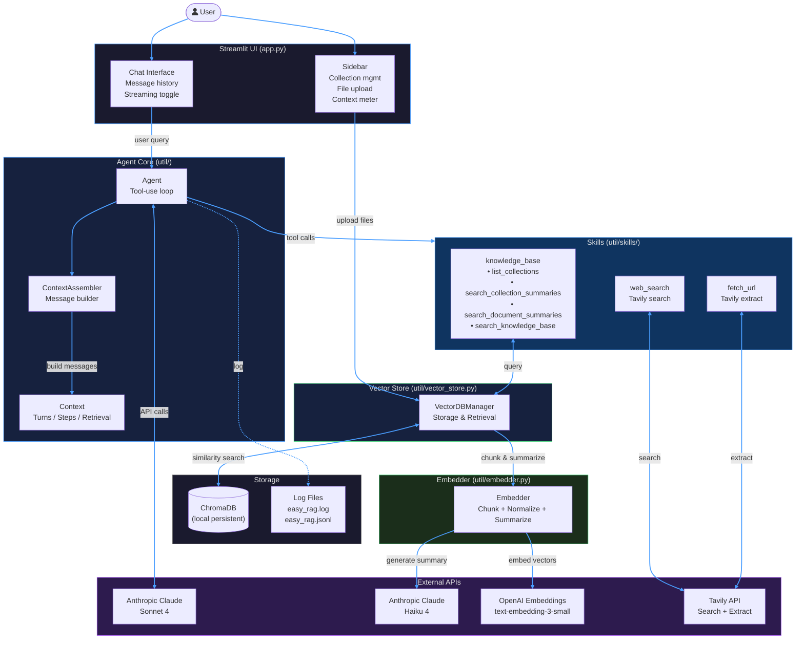
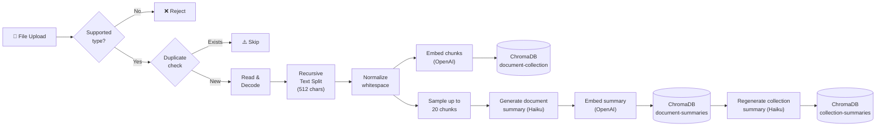
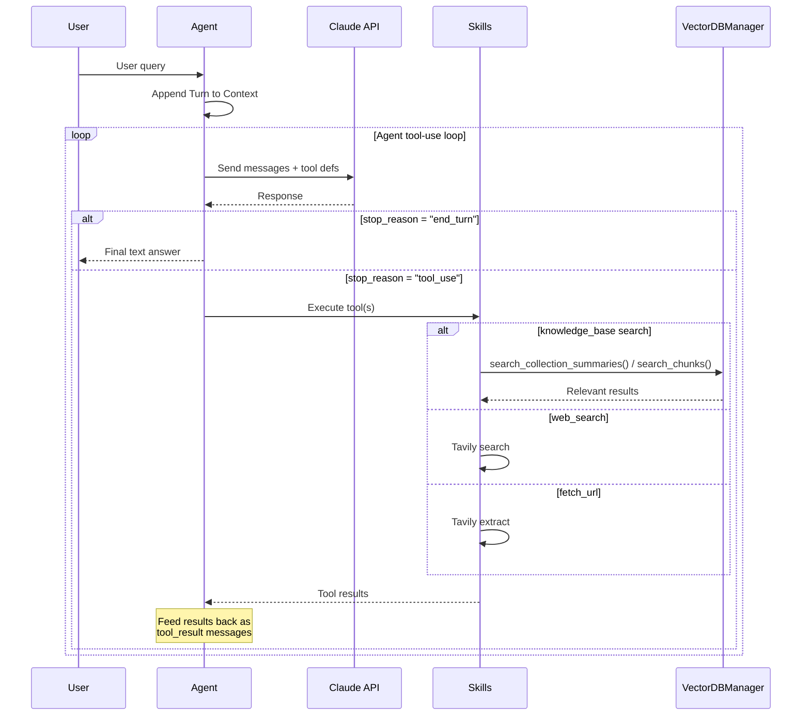

# ⬡ EasyRAG

A lightweight Retrieval-Augmented Generation (RAG) application built with Streamlit, Claude (Anthropic), and ChromaDB. Upload your documents, ask questions, and get answers grounded in your own data — with web search as a fallback.


---

## Features

- **Document Ingestion** — Upload `.txt`, `.md`, and `.docx` files; they are chunked, normalized, and embedded into ChromaDB collections
- **Three-Tier Summaries** — Each document gets a one-sentence summary, and each collection gets a synthesized summary (generated by Claude Haiku) for fast, hierarchical triage
- **Agentic RAG** — An agentic tool-use loop lets Claude autonomously decide when to list collections, search summaries, search chunks, search the web, or fetch a URL
- **Collection Management** — Create named collections to organize documents by topic, project, or domain
- **Web Search & Fetch** — Tavily-powered web search and page extraction for questions outside your local corpus
- **Context Window Meter** — Visual sidebar gauge shows how much of the model's 128k context is in use
- **Streaming Responses** — Toggle real-time token streaming on or off
- **Structured Logging** — Dual-format logging (plain text + redacted JSON Lines) with automatic API key scrubbing

---

## System Architecture

### High-Level Overview



### Document Ingestion Pipeline



### Agent Query Loop



---

## Project Structure

```
EasyRag/
├── app.py                      # Streamlit UI — sidebar, chat, file upload
├── config.py                   # Supported MIME types, system prompt
├── style.py                    # Custom dark-theme CSS (IBM Plex fonts)
│
├── util/
│   ├── __init__.py             # Package exports, loads .env
│   ├── agent.py                # Agent class — tool-use loop over Anthropic API
│   ├── context.py              # Context / Turn / Step / RetrievalContext dataclasses
│   ├── ContextAssembler.py     # Builds API message list from Context history
│   ├── embedder.py             # Document chunking, normalization, summary generation
│   ├── logging_utils.py        # Dual-format logger with API key redaction
│   ├── vector_store.py         # ChromaDB persistence and 3-tier retrieval hierarchy
│   │
│   └── skills/
│       ├── __init__.py         # SkillRegistry assembly
│       ├── base.py             # Skill + SkillRegistry abstractions
│       ├── knowledge_base.py   # ChromaDB search tools (4 skills)
│       ├── web_search.py       # Tavily web search skill
│       └── fetch_url.py        # Tavily page extraction skill
│
├── chroma_db/                  # Persistent ChromaDB storage (auto-created)
├── data/                       # Sample documents for testing
├── log/                        # Runtime logs (easy_rag.log, easy_rag.jsonl)
├── scripts/                    # Utility scripts (e.g. inspect Chroma collections)
│
├── .env                        # API keys (DO NOT commit — see Security below)
├── .gitignore
└── LICENSE                     # MIT
```

---

## Getting Started

### Prerequisites

- Python 3.11+
- API keys for:
  - [Anthropic](https://console.anthropic.com/) — LLM (Claude Sonnet 4 + Haiku 4)
  - [OpenAI](https://platform.openai.com/) — Embeddings (`text-embedding-3-small`)
  - [Tavily](https://tavily.com/) — Web search & page extraction

### Installation

```bash
# Clone the repo
git clone https://github.com/JosiahKeime/EasyRag.git
cd EasyRag

# Create and activate a virtual environment
python -m venv .venv
# Windows
.venv\Scripts\activate
# macOS/Linux
source .venv/bin/activate

# Install dependencies
pip install streamlit anthropic chromadb langchain-chroma langchain-openai langchain-text-splitters python-dotenv tavily-python
```

### Configuration

Create a `.env` file in the project root:

```env
ANTHROPIC_API_KEY=sk-ant-...
OPENAI_API_KEY=sk-proj-...
TAVILY_KEY=tvly-...
```

### Run

```bash
streamlit run app.py
```

The app opens at `http://localhost:8501`. Use the sidebar to create a collection, upload documents, then start chatting.

---

## How It Works

### 1. Upload & Embed
Upload a `.txt`, `.md`, or `.docx` file via the sidebar. The **Embedder** splits it into 512-character chunks with 64-character overlap, and normalizes whitespace. **VectorDBManager** stores the vectors in ChromaDB using OpenAI's `text-embedding-3-small` model. A one-sentence document summary is generated by Claude Haiku and stored in a separate `document-summaries` collection. Finally, a single-sentence collection summary is regenerated and stored in `collection-summaries`.

### 2. Ask a Question
Type a question in the chat box. The **Agent** sends your full conversation history (managed by the **ContextAssembler**) to Claude Sonnet 4 along with tool definitions.

### 3. Agentic Tool Use
Claude decides which tools to call — it might:
- **List collections** to get an overview of available collections
- **Search collection summaries** to identify which collections are most relevant
- **Search document summaries** to identify relevant documents within a collection
- **Search the knowledge base** to retrieve specific passages from those documents
- **Search the web** via Tavily for current information
- **Fetch a URL** to extract full page content

The Agent loops until Claude produces a final text answer (`end_turn`).

---

## Adding a New Skill

The skills system is designed for easy extension:

1. Create `util/skills/your_skill.py` with a `register(registry)` function
2. Use the `@registry.register(name=..., description=..., input_schema=...)` decorator
3. Import and call it in `util/skills/base.py` → `build_default_registry()`

See [`web_search.py`](util/skills/web_search.py) for a minimal example.

---

## Security

> ⚠️ **Important**: Never commit API keys to version control. Add `.env` to your `.gitignore`:
>
> ```gitignore
> .env
> ```
>
> If keys have been previously committed, rotate them immediately on each provider's dashboard.

---

## License

[MIT](LICENSE) © 2026 JosiahKeime
